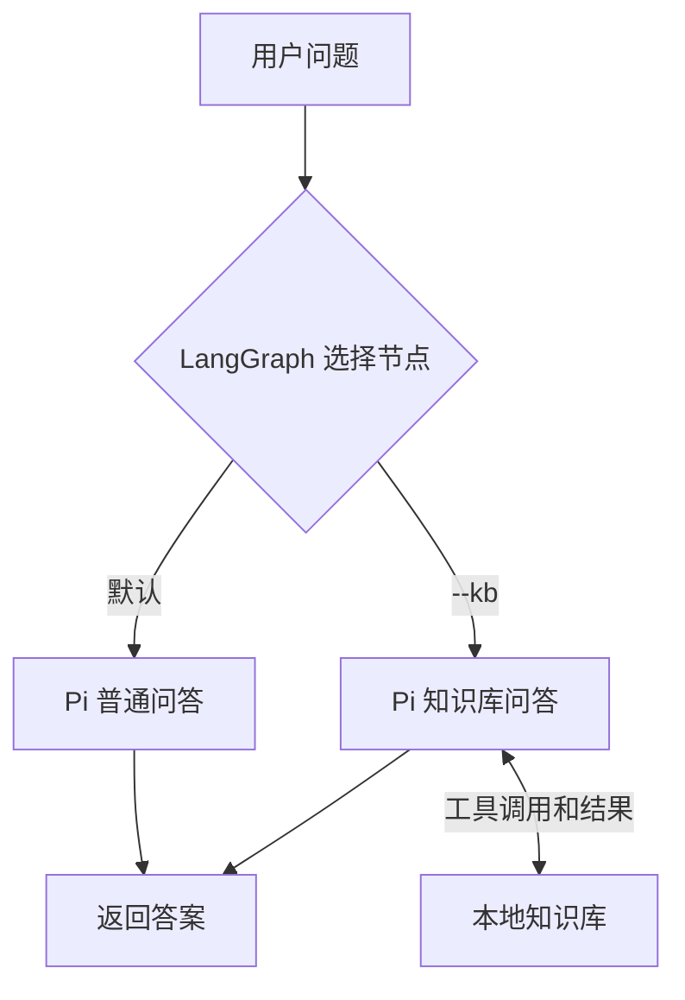

# langgraph-pi

一个用 LangGraph.js 编排工作流、用 pi-agent-core 执行节点的 TypeScript 项目骨架。示例提供普通问答和公司制度问答两个入口。



- **LangGraph** 持有工作流状态。通过输入的 `mode` 选择节点，接收节点返回的 `answer` 和 `toolsUsed`。
- **Pi** 在节点内创建独立的 Agent，处理模型调用、工具参数、工具执行和结果回传。知识库分支传入 `search_knowledge`，普通问答分支的工具列表为空。
- **演示模型** 按脚本返回普通答复和知识库工具调用。图、Agent 循环和本地工具照常执行，演示会检查两个分支以及工具是否实际成功调用。

## 本地运行

需要 Node.js 22.19 或更新版本。

```bash
npm install
npm run check
npm run demo
```

接入真实 OpenAI 模型时，复制 `.env.example` 为 `.env`，填入 `OPENAI_API_KEY`，可用 `PI_MODEL` 选择 Pi 已注册的 OpenAI 模型。

```bash
cp .env.example .env
# 填入 .env 后执行
npm start -- "用一句话解释 RRF"
npm start -- --kb "差旅报销期限是多久？"
```

## 代码入口

| 文件 | 职责 |
| --- | --- |
| `src/workflow/graph.ts` | 定义图状态、条件边和执行节点 |
| `src/pi/runner.ts` | 把节点参数映射到 Pi，抽取答案和成功执行的工具名 |
| `src/tools/knowledge.ts` | 定义工具 schema，并查询两条示例制度 |
| `src/cli.ts` | 解析命令行参数并装配真实模型 |
| `src/demo.ts` | 注入本地模型，跑通两个分支 |

接自己的 RAG 时，可以先保留 `search_knowledge` 的接口，把内存查询换成检索服务调用。想增加文档分析流程，可以在图里注册新节点，并为该节点传入专用系统提示词和工具。每次启动 CLI 都运行一个独立任务，当前状态只在该次运行期间存在。

## 上游文档

- [LangGraph.js Graph API](https://docs.langchain.com/oss/javascript/langgraph/graph-api)
- [pi-agent-core](https://github.com/earendil-works/pi/tree/v1.6.0/packages/agent)
